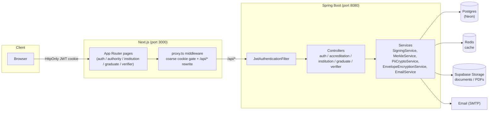
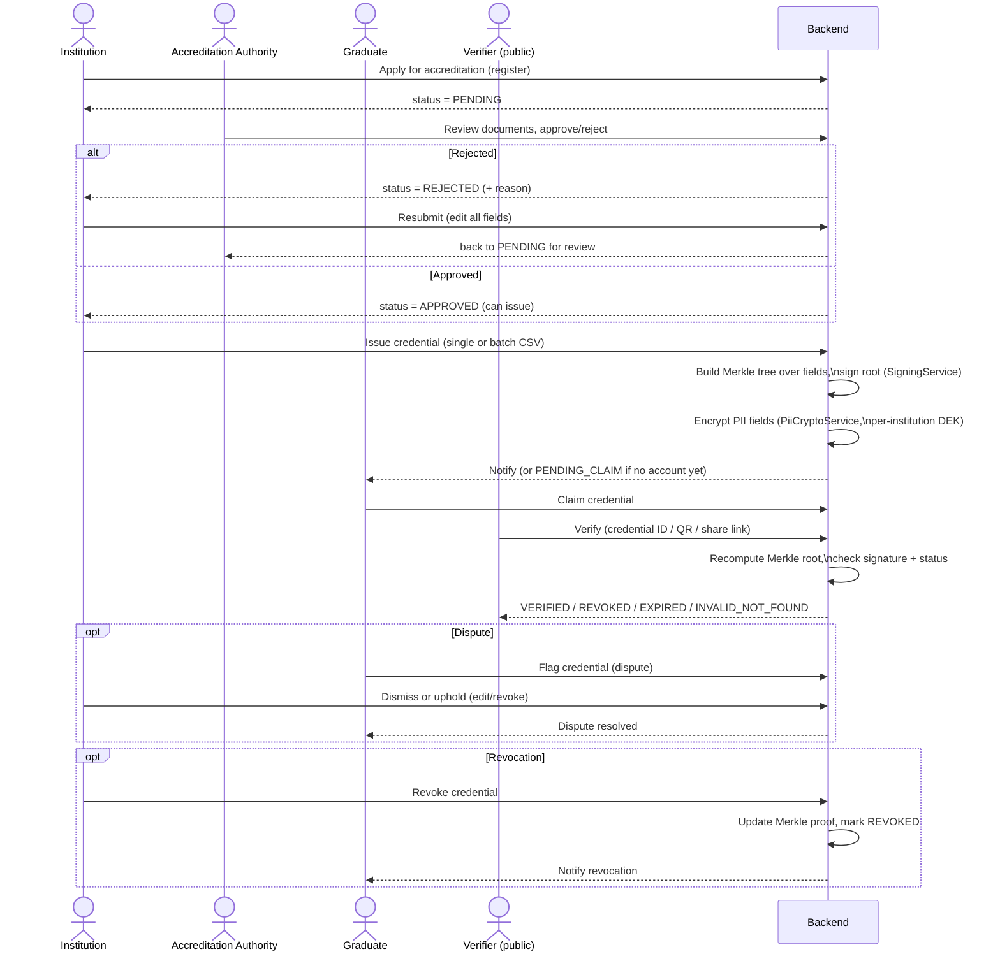

# CertiChain Architecture Overview

## High-Level Structure

```
certichain-backend/   — Spring Boot 4 (Java 21), REST API + PostgreSQL
certichain-frontend/  — Next.js 16 (React 19), TypeScript, Tailwind CSS 4
```

---

## Diagrams

### System components & request path



### End-to-end credential lifecycle



---

## Backend (Spring Boot)

### Tech Stack
- **Java 21**, Spring Boot 4, Spring Security, Spring Data JPA
- **PostgreSQL** (Neon serverless) with Flyway migrations
- **JJWT 0.12.6** for HMAC-signed JWTs
- **Maven** build

### Module Layout
```
com.certichain.certichainbackend
├── auth/                    # Login, signup, JWT, password reset
├── accreditation/           # AA portal: registry, document review, decisions, audit log
├── institution/             # Institution portal: issue, batch, revoke, disputes, analytics, settings
├── graduate/                # Graduate portal: credentials, timeline, shares, disputes
├── verifier/                # Public verify: single, bulk, QR (JSON), trust stats
├── notification/            # Bell notifications across portals
├── briefing/                # Institution briefing card (recent changes)
├── common/
│   ├── entity/              # JPA entities (User, Credential, Share, DisputeFlag, etc.)
│   ├── service/             # SigningService, MerkleService, NotificationService, AuditLogService, SupabaseStorageService
│   ├── exception/           # GlobalExceptionHandler, ApiException, ValidationException, ForbiddenActionException
│   ├── dto/                 # ErrorResponse, ApiResponse
│   └── enums/               # Role, CredentialStatus, VerificationResult, InstitutionStatus, etc.
└── config/                  # SecurityConfig, CacheConfig
```

### Auth Model
- **Stateless JWT** in HttpOnly cookie (`jwt`), 12h expiry, HMAC-SHA256
- Single token type for all 4 roles: `ACCREDITATION_AUTHORITY`, `INSTITUTION`, `GRADUATE`, (verifier is public)
- Per-request filter (`JwtAuthenticationFilter`) reads cookie → validates → populates `SecurityContext`
- Role re-read from DB on every request (stale token reflects current state)

### Data Integrity
- **Merkle tree** per credential: fields → leaves → root → HMAC signature
- Tamper detection: verify recomputes root; mismatch → `INVALID_NOT_FOUND`
- Optimistic locking (`@Version`) on Institution, Credential, DisputeFlag, Share
- Signing is currently a **shared app-wide HMAC secret** (`SigningServiceImpl`), not per-institution asymmetric keys — proves "issued by this backend," not "issued by this institution." `Institution.publicKey`/`privateKeyEnc` columns exist but are unpopulated scaffolding for a future real keypair.
- Not a blockchain: single Postgres DB, single backend, no hash-chained/append-only ledger, no distributed consensus. "Blockchain-inspired" refers to the Merkle-proof verification model only.

### PII Encryption
- **Envelope encryption**: AES-256-GCM, random 12-byte IV per call, 128-bit auth tag (`EnvelopeEncryptionServiceImpl`)
- Root KEK from `ENCRYPTION_KEK` env var; per-institution DEK minted, wrapped by KEK, stored on `Institution` (`dek_wrapped`, `dek_iv`)
- `PiiCryptoService` is the single choke point: encrypts graduate email (KEK-direct, + HMAC blind index for exact-match lookup), institution PII fields, credential titles/revoke reasons, dispute reason/resolution notes (all DEK)
- Rotation is **manual, one-time**: `LegacyEncryptionBackfill` (flag-gated CommandLineRunner) mints DEKs / re-wraps under a new KEK on demand — no automated rotation pipeline
- Known gap: KEK lives in an env var, not a KMS/HSM (documented tradeoff, not an oversight)

### Key Flows
1. **Institution registration** → 3-step wizard → `PENDING` → AA reviews docs → `APPROVED` → can issue
2. **Single issuance** → signed credential → graduate notified (or `PENDING_CLAIM` if no account)
3. **Batch issuance** → CSV (≤5000 rows) → per-row results, one `batchId`, partial success allowed
4. **Revocation** → single or batch → Merkle proof updated → graduate notified
5. **Shares** → graduate creates tokenized link → selective field disclosure → view tracking
6. **Disputes** → graduate flags → institution dismisses/upholds (edit or revoke)
7. **Verification** → public `/verify` (rate-limited 30/min/IP) → returns `VERIFIED/REVOKED/EXPIRED/INVALID_NOT_FOUND`

---

## Frontend (Next.js 16)

### Tech Stack
- **React 19**, Next.js 16 (App Router), TypeScript
- **Tailwind CSS 4**, shadcn-style UI components
- **TanStack Query v5** for server state
- **Zustand** for auth store (`{user, isAuthenticated}`)
- **Axios** with custom `ApiClient` (cookie-first, fetch for multipart)
- **Vitest** + React Testing Library

### Route Groups (App Router)
```
(app)
├── (auth)/                  # login, register, register/graduate, forgot-password, reset-password
├── (authority)/             # AA portal (dashboard, registry, documents, decision, audit-log, settings)
├── (institution)/           # Institution portal (dashboard, issue, activity-records, batch, batches, disputes, analytics, settings, credentials/[id])
├── (graduate)/              # Graduate portal (overview, credentials, credentials/[id], timeline, shares, disputes, settings)
├── (verifier)/              # Public verify, verify/bulk, institutions directory
├── share/[token]/           # Public shared timeline
└── layout.tsx / page.tsx    # Landing + providers
```

### Auth Flow
1. `useLogin`/`useSignup` → `authService.login`/`signup` (`withCredentials: true`)
2. On success → `useAuthStore.setSession(user)` → router pushes to role home
3. `useMe` re-hydrates from `GET /api/auth/me` on hard refresh (cookie is HttpOnly)
4. Middleware (`proxy.ts`) coarse-gates portals by cookie presence; backend enforces RBAC

### Error Handling Gap (Documented)
- Backend returns `{error: "...", code: "..."}`
- Frontend `ApiClient` throws flat `{message, status}` → components read `.message` → generic fallback shown
- Workaround: check Network tab for real message

---

## Infrastructure

- **Database**: Neon Postgres (serverless, branching, autoscaling)
- **File Storage**: Supabase Storage (via `SupabaseStorageService`)
- **Email**: Spring Boot Mail (Resend in prod, console log in dev)
- **Dev**: `mvnw spring-boot:run` (port 8080) + `npm run dev` (port 3000, proxies `/api/*` to backend)

---

## Known Technical Debt (from PONYTAIL-DEBT.md)

| Area | Issue |
|------|-------|
| JWT Filter | Swallows invalid/expired tokens on permitAll routes; protected routes get opaque 403 |
| JWT Expiry | Fixed 12h, no refresh tokens |
| CORS | Allows any `localhost:*` port |
| Verify QR | File upload only (expects JSON `{credentialId}`), no camera scan |
| Bulk Verify CSV | One ID per line, no quoting/multi-column |
| Rate Limits | In-memory, resets on restart, no cross-instance sharing |
| Notification Prefs | UI only, reset on refresh |
| Search | Registry/audit-log filter loaded page only |
| CSV Parsing | Naive `split(",")`, no quoted values |
| Error Banners | Generic fallback (frontend reads `.message`, backend sends `.error`) |
| Single Revoke | No idempotency guard (duplicate notifications) |